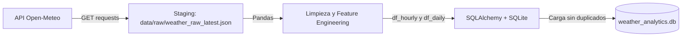

# Pipeline ETL Meteorológico con Persistencia en SQLite y SQLAlchemy

**Curso:** Data Science II - Coderhouse  
**Entregable:** Pre-entrega 8 — Persistencia y la integración de scripts ETL (Módulo 9)  

---

## 1. Descripción del Proyecto

Este proyecto implementa un flujo automatizado de extracción, transformación y carga (**ETL**) de datos meteorológicos a nivel principiante, cumpliendo con todos los requisitos solicitados en la pre-entrega:

1. **Extracción (Extract):** Conecta con una fuente de datos pública (la **API Open-Meteo** para la ciudad de Buenos Aires) y almacena una copia de los datos crudos en formato JSON en una carpeta de transición (**Staging Area**).
2. **Transformación (Transform):** Limpia los datos usando **Pandas**, trata los valores nulos, ajusta tipos de datos (fechas), genera nuevas variables (clasificación del viento y lluvia) y calcula un resumen analítico diario.
3. **Carga y Persistencia (Load):** Conecta y almacena los datos procesados en una base de datos local **SQLite** utilizando **SQLAlchemy**.
4. **Prevención de Duplicados:** Implementa una lógica sencilla para evitar insertar registros repetidos si el script se ejecuta más de una vez.
5. **Consultas SQL:** Incluye un script de verificación que ejecuta consultas SQL para analizar la información guardada.

---

## 2. Estructura del Repositorio

El proyecto está organizado de forma modular para separar claramente las responsabilidades:

```text
Pre-entrega 8- Persistencia y la integración de scripts ETL/
│
├── config/
│   ├── __init__.py
│   └── settings.py          # Configuración básica (rutas, coordenadas y variables)
│
├── data/
│   ├── raw/                 # Staging Area para guardar el JSON crudo
│   │   ├── .gitkeep
│   │   └── weather_raw_latest.json
│   └── weather_analytics.db # Base de datos SQLite (se genera al ejecutar)
│
├── sql/
│   └── create_tables.sql    # Script DDL en SQL para crear las tablas e índices
│
├── src/
│   ├── __init__.py
│   ├── models.py            # Definición de tablas con SQLAlchemy (Mapeo ORM)
│   ├── extract.py           # Función para consultar la API y guardar en raw
│   ├── transform.py         # Limpieza, conversión de fechas y resumen diario con Pandas
│   └── load.py              # Funciones para conectar a SQLite y guardar sin duplicar
│
├── main.py                  # Script principal que ejecuta el pipeline ETL completo
├── verify_persistence.py    # Script para comprobar y consultar los datos con SQL
├── requirements.txt         # Lista de dependencias necesarias (pip)
├── .env.example             # Ejemplo de variables de entorno configurables
├── .gitignore               # Archivos excluidos del repositorio (bases de datos, caches)
└── README.md                # Documentación del proyecto
```

---

## 3. Flujo del Pipeline (ETL)

El flujo se divide en tres pasos secuenciales orquestados desde `main.py`:



### Paso 1: Extracción (`src/extract.py`)
- Realiza una consulta HTTP GET a la API gratuita de Open-Meteo para obtener datos horarios de los últimos 7 días y el pronóstico de los próximos 3 días.
- Guarda la respuesta cruda en `data/raw/weather_raw_latest.json`. Esto cumple con el patrón de **Staging Area** (área de transición), garantizando que tengamos un respaldo de los datos tal como llegaron de la fuente.
- Si no hay conexión a internet, el script detecta el error y carga automáticamente el último archivo guardado en Staging para que el proceso no se interrumpa.

### Paso 2: Transformación (`src/transform.py`)
- Convierte el diccionario JSON en un DataFrame de Pandas.
- Convierte la columna de texto de fecha/hora en tipo `datetime` (`pd.to_datetime`).
- **Tratamiento de nulos:**
  - Descarta filas donde falte la fecha o la temperatura (datos esenciales no recuperables).
  - Rellena valores nulos de precipitación con `0.0` (asumiendo ausencia de lluvia).
  - Rellena humedad faltante con la mediana de la columna.
- **Feature Engineering (Nuevas columnas):**
  - `wind_category`: Clasifica la velocidad del viento en categorías comprensibles (*Calma / Viento Leve*, *Brisa Moderada*, *Viento Fuerte*, *Temporal*).
  - `is_rainy`: Variable booleana (`True` / `False`) que indica si hubo precipitación mayor a 0 mm.
  - `ingested_at`: Fecha y hora exacta de procesamiento.
- **Resumen Diario Agregado:**
  - Agrupa por `city` y `date` para calcular: temperatura mínima, temperatura máxima, temperatura promedio, lluvia acumulada del día y velocidad promedio del viento.

### Paso 3: Carga y Persistencia (`src/load.py`)
- Crea el motor de base de datos con `create_engine()` de SQLAlchemy.
- Crea las tablas automáticamente si no existen (`Base.metadata.create_all()`).
- Guarda los datos en dos tablas: `weather_hourly` (mediciones por hora) y `weather_daily_summary` (resumen diario).
- **Evita duplicados:** Antes de guardar, consulta qué fechas u horas ya existen en la base de datos. Solo inserta las filas nuevas mediante `df.to_sql(..., if_exists="append")`.

---

## 4. Esquema de Base de Datos (DDL)

El diseño relacional se compone de dos tablas en SQLite:

### Tabla 1: `weather_hourly` (Mediciones Horarias)
| Columna | Tipo SQL | Descripción |
| :--- | :--- | :--- |
| `id` | `INTEGER PRIMARY KEY` | Identificador único autoincremental |
| `city` | `VARCHAR(50)` | Nombre de la ciudad (ej: Buenos Aires) |
| `timestamp` | `DATETIME` | Fecha y hora de la medición |
| `temperature_c` | `REAL` | Temperatura registrada en °C |
| `humidity_pct` | `REAL` | Porcentaje de humedad relativa |
| `precipitation_mm` | `REAL` | Milímetros de lluvia caída |
| `wind_speed_kmh` | `REAL` | Velocidad del viento en km/h |
| `wind_category` | `VARCHAR(30)` | Categoría del viento (ej: Brisa Moderada) |
| `is_rainy` | `BOOLEAN` | Si hubo lluvia (True/False) |
| `ingested_at` | `DATETIME` | Fecha y hora en que se guardó en la base |

### Tabla 2: `weather_daily_summary` (Resumen Diario Agregado)
| Columna | Tipo SQL | Descripción |
| :--- | :--- | :--- |
| `id` | `INTEGER PRIMARY KEY` | Identificador único autoincremental |
| `city` | `VARCHAR(50)` | Ciudad |
| `date` | `DATE` | Fecha del día analizado |
| `temp_min_c` | `REAL` | Temperatura mínima del día (°C) |
| `temp_max_c` | `REAL` | Temperatura máxima del día (°C) |
| `temp_avg_c` | `REAL` | Temperatura promedio del día (°C) |
| `total_precipitation_mm` | `REAL` | Lluvia total acumulada en el día (mm) |
| `avg_wind_speed_kmh` | `REAL` | Velocidad media del viento (km/h) |
| `rainy_hours_count` | `INTEGER` | Cantidad de horas con lluvia en el día |
| `ingested_at` | `DATETIME` | Fecha y hora de procesamiento |

El script SQL completo para crear estas tablas se encuentra en [`sql/create_tables.sql`](sql/create_tables.sql).

---

## 5. Requisitos y Configuración del Entorno

### Requisitos previos
- Python 3.10 o superior instalado.
- Gestor de paquetes `pip`.

### Paso 1: Clonar o descargar el repositorio
```bash
git clone <URL_DEL_REPOSITORIO>
cd "Pre-entrega 8- Persistencia y la integración de scripts ETL"
```

### Paso 2: Crear y activar un entorno virtual

**En Windows (PowerShell):**
```powershell
python -m venv venv
.\venv\Scripts\Activate.ps1
```

**En Linux / macOS:**
```bash
python3 -m venv venv
source venv/bin/activate
```

### Paso 3: Instalar las dependencias
```bash
pip install -r requirements.txt
```

### Paso 4: Variables de entorno (Opcional)
El proyecto incluye un archivo `.env.example`. Si deseas personalizar la ciudad o coordenadas, puedes crear un archivo `.env`:
```bash
cp .env.example .env
```
*(Si no creas el archivo `.env`, el sistema usará automáticamente los valores por defecto de Buenos Aires definidos en `config/settings.py`)*.

---

## 6. Pasos para Ejecutar

### 1. Ejecutar el Pipeline ETL
Para iniciar el proceso completo de extracción, limpieza y carga en la base de datos:
```bash
python main.py
```

**Salida en consola:**
```text
=================================================================
 INICIANDO PIPELINE ETL DE CLIMA (Coderhouse Data Science II)
 Ciudad: Buenos Aires
 Base de Datos: sqlite:///.../data/weather_analytics.db
=================================================================

[PASO 1] Conectando a SQLite y verificando tablas...
[DB] Verificando esquema de tablas en SQLite...
[DB] Tablas verificadas exitosamente.

[PASO 2] Extrayendo datos de la API pública...
[EXTRACT] Consultando API Open-Meteo para Buenos Aires...
[EXTRACT] Datos crudos guardados correctamente en Staging: weather_raw_latest.json
-> Extracción completada.

[PASO 3] Limpiando datos y calculando agregaciones...
[TRANSFORM] Filas crudas recibidas: 240
[TRANSFORM] Transformación completada: 240 registros horarios y 10 resúmenes diarios.
-> Transformación completada.

[PASO 4] Cargando datos en la base de datos local SQLite...
[LOAD] Se insertaron 240 nuevos registros en 'weather_hourly'.
[LOAD] Se insertaron 10 nuevos resúmenes en 'weather_daily_summary'.
-> Carga completada.

[PASO 5] Verificando métricas de persistencia...
-----------------------------------------------------------------
 RESUMEN EN BASE DE DATOS:
  - Total registros en 'weather_hourly': 240
  - Total resúmenes en 'weather_daily_summary': 10
-----------------------------------------------------------------

¡Pipeline ETL finalizado con éxito!
```

### 2. Probar la prevención de duplicados (Idempotencia)
Si vuelves a ejecutar inmediatamente el pipeline:
```bash
python main.py
```
El script detectará que esos días ya fueron guardados y no duplicará ningún registro:
```text
[LOAD] Todos los registros horarios ya estaban en la base de datos. Ninguno duplicado.
[LOAD] Todos los resúmenes diarios ya existían en la base de datos. Ninguno duplicado.
```

### 3. Verificar y consultar la base de datos con SQL
Para auditar la base de datos y correr consultas analíticas:
```bash
python verify_persistence.py
```

Este script ejecutará consultas como:
- Conteo total de filas en ambas tablas.
- Top 5 horas con mayor temperatura registrada.
- Resumen de días con precipitaciones acumuladas.
- Agrupación de horas por categoría de viento.

---

## 7. Justificación de Decisiones Técnicas

- **¿Por qué SQLite?** SQLite es una base de datos relacional ligera que almacena todo en un único archivo local (`.db`). No requiere instalar un servidor externo, lo que facilita la reproducibilidad del proyecto en cualquier computadora.
- **¿Por qué SQLAlchemy?** Es el estándar de la industria en Python para comunicarse con bases de datos relacionales, proporcionando tanto creación de tablas mediante modelos (ORM) como ejecución segura de consultas SQL.
- **¿Por qué Staging Area?** Guardar el archivo JSON crudo en `data/raw/` permite aislar los datos originales de cualquier manipulación y garantiza que el pipeline pueda volver a ejecutarse aunque la API externa esté temporalmente caída.
